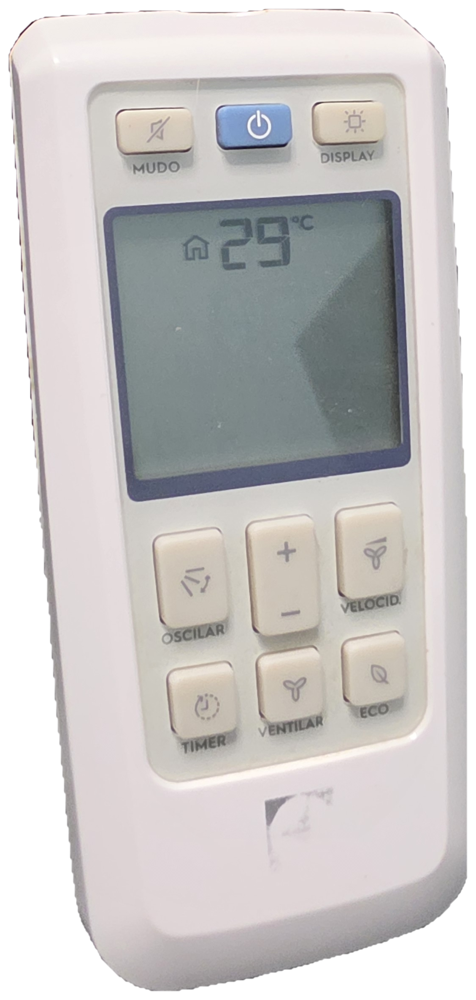
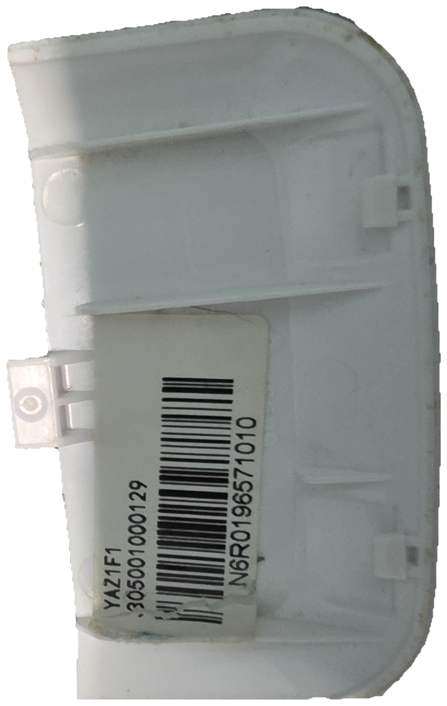
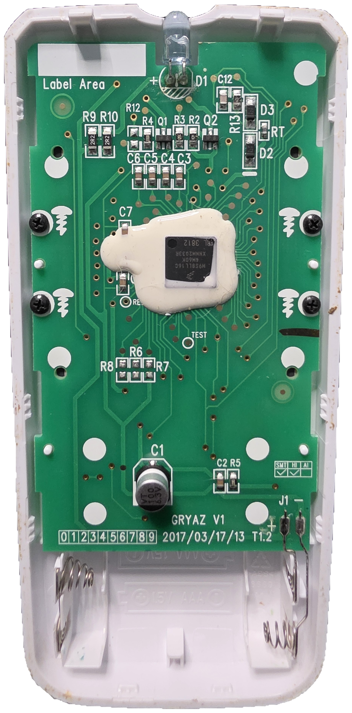
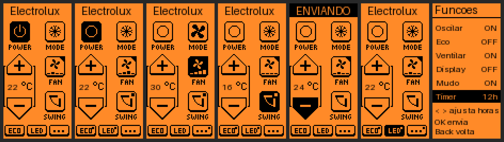

# Electrolux AC Remote — app para Flipper Zero

App no mesmo estilo do **Samsung AC Remote** / **Hitachi AC Remote**: guarda o estado do ar (como o controle
original) e, a cada tecla, calcula e envia o sinal IR completo. Cobre qualquer combinação de temperatura (16–30 °C),
velocidade (mínima/média/alta/turbo), Oscilar, Eco, Ventilar, Display, Mudo e Timer (1–24 h).

## O controle original

Fotos do controle que foi decifrado (fundo removido, PNG transparente), em `docs/` (aqui: `docs/`).

| Frente | Etiqueta na tampa das pilhas | Placa interna |
|:--:|:--:|:--:|
|  |  |  |
| `docs/controle_frente.png` | `docs/controle_etiqueta_tampa.png` | `docs/controle_placa_interna.png` |

- **Frente:** teclas `MUDO`, liga/desliga, `DISPLAY`, `OSCILAR`, `+` / `−`, `VELOCID.`, `TIMER`, `VENTILAR` e `ECO`; visor LCD
  (na foto, 29 °C). São as teclas que o app reproduz.
- **Etiqueta da tampa:** código do controle **`YAZ1F1`**, mais os números `305001000129` (o primeiro caractere está
  coberto pela etiqueta) e `N6R0196571010`, também em código de barras.
- **Placa interna:** serigrafia **`GRYAZ V1`**, data **`2017/03/17/13`**, revisão **`T1.2`**; LED infravermelho **D1** na borda
  superior (é de lá que sai o sinal — aponte essa ponta para o ar); microcontrolador coberto por resina; alimentação 2 × AAA (1,5 V).
- Os nomes `YAZ1F1` / `GRYAZ` seguem a nomenclatura de controles OEM da Gree, o que **combina** com o formato Gree decifrado
  nos sinais. É um indício, não uma confirmação do modelo do ar.

## Instalação

Copie o `.fap` do seu firmware para `/ext/apps/Infrared/` no cartão SD (qFlipper ou app do celular).
Abra: **Apps → Infrared → Electrolux AC Remote**.

| Pasta | Firmware | API |
|---|---|---|
| `unleashed-094/electrolux_ac.fap` | **Unleashed `unlshd-094`** (o do dono do projeto) | 88.19 |
| `oficial/electrolux_ac.fap` | Oficial 1.5.1 | 88.2 |

O `.fap` é compilado para a API de um firmware específico. Para outro (Momentum, Unleashed de outra versão…),
se aparecer "API mismatch", compile para o seu firmware:

```
pip install ufbt
cd fonte
ufbt update --index-url=<índice do seu firmware> --channel=release   # ex. Momentum: https://up.momentum-fw.dev/firmware/directory.json
ufbt                                                                  # gera dist/electrolux_ac.fap
```

## Comandos

A tela é **vertical**, como nos apps *AC Remote* de Midea/Hitachi: gire o Flipper para ler. Navegue com as setas; o botão
em **foco** fica invertido e o `OK` aciona. Um **quadradinho no canto** do botão indica função ligada; o **triângulo** no
`FAN` indica que **segurar o `OK` faz outra ação** (diminuir a velocidade). O design é copiado do app Midea AC Remote
(veja *Créditos e licenças*).



| Botão | `OK` faz |
|---|---|
| **POWER** | liga/desliga. O ícone mostra o estado, como nos apps de referência: **símbolo de ligar** (anel com traço) = ar desligado; **anel fechado** = ar ligado |
| **MODE** | alterna Normal (ícone de floco) ↔ **Ventilar** (ícone de ventilador) |
| **+** / **−** | temperatura 16–30 °C (segurar `OK` repete) |
| **FAN** | **aumenta** a velocidade (mín → média → alta → turbo → mín); `OK` **segurado** **diminui** |
| **SWING** | oscilar |
| **ECO** / **LED** | eco / luz do display |
| **···** | abre as funções: Oscilar, Eco, Ventilar, Display, Mudo e **Timer** (`Esq`/`Dir` mudam as horas, 0–24; `OK` envia) |

Com o timer ativo, o botão `···` ganha o quadradinho de "ligado". `Back` volta/sai. Cada tecla envia o **estado completo**,
como o controle. O último estado fica salvo em `/ext/apps_data/electrolux_ac/`. A pré-visualização é aproximada (a fonte real do Flipper é outra).

## O que foi validado e o que não foi

- O gerador em C reproduz o gerador Python em 20.000 estados aleatórios; o modelo reproduz, bit a bit, as 22 gravações
  reais do controle (inclui `off`/1 h/2 h do Timer).
- O app compilou com o SDK oficial, mas **não foi executado num Flipper nem testado no ar real**.
- **Extrapolado** (sem gravação): temperaturas fora de 20–24 °C, Timer acima de 2 h, combinações que o controle talvez nunca envie.
- **Suposição:** com o timer ligado, as demais teclas continuam enviando o timer no estado (como os controles Gree).
  Se uma tecla falhar com timer ativo, desligue o timer (Funções → Timer → OFF → OK) e tente de novo.

## Créditos e licenças

O **design da interface** (disposição dos botões, ícones e rótulos) foi **copiado e adaptado** do app
[**Midea AC Remote**](https://github.com/xakep666/flipperzero-midea-ac-remote), de Vladimir Stoliarov (MIT), que é baseado no
[**Mitsubishi AC Remote**](https://github.com/achistyakov/flipperzero-mitsubishi-ac-remote), de Anton Chistyakov (MIT), e
compartilha o mesmo design do [**Hitachi AC Remote**](https://github.com/dogtopus/flipperzero-hitachi-ac-remote), de dogtopus (MIT).

- Ícones usados **sem alteração**: `on`, `off`, `cold`, `fan`, `tempup`, `tempdown` (e versões *hover*), `frame_30x39` e os rótulos de texto.
- Ícones **derivados** por este projeto a partir deles (`tools_make_assets.py`): moldura do `FAN` (com a hélice do [**Samsung AC Remote**](https://github.com/dappermint/samsung-ac-remote-flipper-app), de Lia Yoffe, MIT), `swing` e `led` sem o triângulo, `eco` e `···`.
- Adaptações: `MODE` alterna Normal ↔ Ventilar; `FAN` mostra a hélice e **4 barras de velocidade embaixo**; `ECO` no lugar do *Turbo* e
  `···` (funções) no lugar do *Clean*.
- É **original** deste projeto: o cálculo do sinal IR do ar Electrolux (`ac_frame.h`) e o restante do código.

Avisos de copyright e o texto da licença MIT: **`CREDITOS_E_LICENCAS.txt`** (incluído no pacote).
